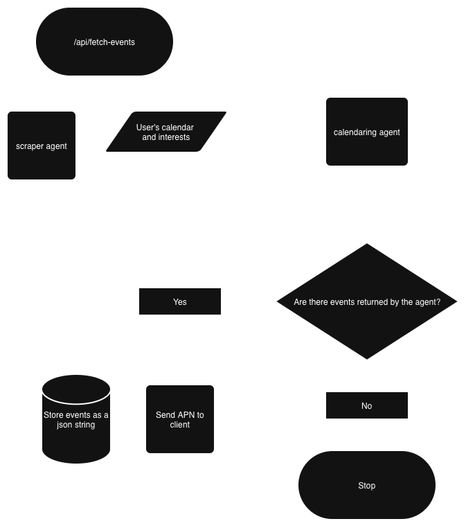

# Campus Select

## Overview

Campus Select started with a problem I frequently encounter as I try to keep up with all the various events and activities that are happening at college and me learning about tools that can be used to harness AI agents.  In an effort to automate this process of sorting and sifting through these activities, I decided to create a fullstack app that takes my calendar and gives it to AI agents that have been programmed to give me a list of events that I can add to my calendar that match my interests and schedule.  The front end, written in SwiftUI, provides the user an intuitive UI to be able to view the events the AI agents has matched with their free time and interests.  The back end, written in Python, utilizes the FastAPI framework so the front end can communicate with the back end and [Google's Agent Development Kit](https://adk.dev) that is designed specifically to empower developers to build AI agents.

## Architecture & System Design

*The pipeline for fetching events based on the user's calendar and interests, triggering the scarper and calendaring agent upon API request.*

## What Can Make This App Better

1) The events that have been scraped by the scraper agent that does not match the user's schedule are tagged, but not filtered out by the calendaring agent.  These events are instead moved to a different list the user can still review so they can determine if they want to move around their schedule for the event.  If the event is against the user's interests, the calendaring agent will continue to not add the event to the list it will return.

2) Add functionality that allows the user to mark certain events to appear less often when new events are fetched. After a certain period of time, these events are no longer filtered out by the calendaring agent. This allows the user to stop seeing certain, often repeated events, from showing up in their feed.  If this features were to be implemented, it would be good to create another agent that takes the structured data returned from the scraper agent and filter it before sending it to the calendaring agent.